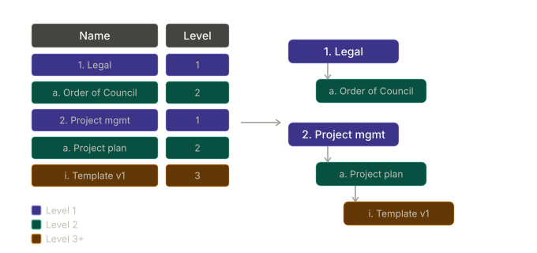

# PowerShell folders and subfolders creator


- [PowerShell folders and subfolders creator](#powershell-folders-and-subfolders-creator)
  - [About](#about)
  - [For whom this script is intended ?](#for-whom-this-script-is-intended-)
  - [How to use](#how-to-use)
    - [1. Download the latest version](#1-download-the-latest-version)
    - [2. Define your folders and subfolders name](#2-define-your-folders-and-subfolders-name)
    - [3. Run the script](#3-run-the-script)

## About

This PowerShell script will read the CSV file and create the folders and subfolders based on the CSV document structure.

## For whom this script is intended ?

This script is intended for people, companies or any other activities that require the frequent creation of long folder (and sub-folder) structures.

This script allows the quick creation of the same folder structures, useful, for example, if you use the same folder structure when starting a new project.

## How to use

### 1. Download the latest version

You can download the latest version on the [releases page](https://github.com/Liozon/powershell-folders-and-subfolders-creator/releases "Releases page")

### 2. Define your folders and subfolders name

Simply edit the `FolderNames.csv` file. You'll find two columns:

1. Column `Name`: use this column to name your folder.
2. Column `Level`: specify if the current line should be either a folder or a subfolder (of the folder specified on top of the subfolder)

The script will use the level to build the sctructure of the folders:



**Reminder**: you **can't** use the following caracters to name your folder:

- `<`
- `>`
- `:`
- `“`
- `/`
- `\`
- `|`
- `?`
- `*`

And the following words:

- `CON`
- `PRN`
- `AUX`
- `NUL`
- `COM1, COM2, COM3, COM4, COM5, COM6, COM7, COM8, COM9`
- `LPT1, LPT2, LPT3, LPT4, LPT5, LPT6, LPT7, LPT8, LPT9`

The CSV file contains random folders name if you want to test the script, with the following structure:

```markdown
1. Legal
  a. Order of the Council of State
1. Project management
  a. Project plan
  b. Description
  c. Project objectives
  d. Legal aspects
  e. Planning
    i. Weekly meetings
    ii. Monthly reports
  f. Test sets
  g. Success indicators
1. Communication
2. Budget
3. Premises - Infrastructure
  a. IT network
  b. Computers
  c. Operating system
  d. Call center
  e. Telephony
```

### 3. Run the script

To run the script, simply double-clic on `Run script.bat`. The BAT file will start PowerShell and the script.
You'll be prompted to confirm the folders creation, no folders will be created before you confirm the script:

